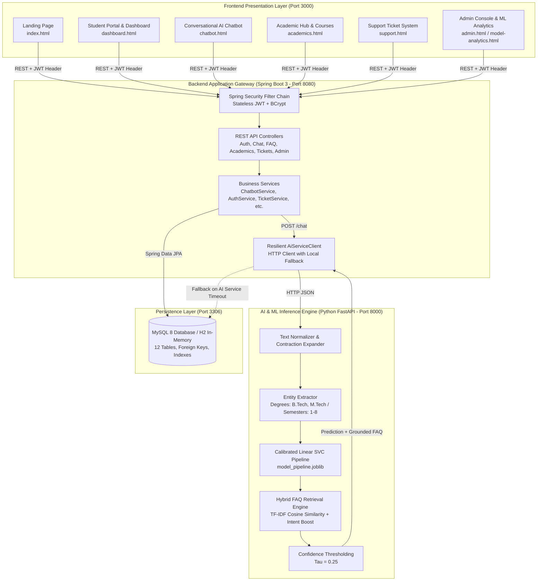

# UniAssist AI – AI-Powered Chatbot for University Student Support Using Machine Learning

[](https://github.com/shagun9639/UniAssist-AI)
[](https://github.com/shagun9639)
[](https://www.oracle.com/java/)
[](https://spring.io/projects/spring-boot)
[](https://www.python.org/)
[](https://fastapi.tiangolo.com/)
[](https://scikit-learn.org/)
[](https://www.mysql.com/)
[](LICENSE)

> A complete, production-grade, end-to-end university student assistance platform powered by traditional explainable Machine Learning (TF-IDF + Calibrated Linear SVC), a resilient Java Spring Boot backend, and a responsive multi-page web frontend.

---

## 1. Executive Summary & Problem Statement

Higher education institutions field tens of thousands of repetitive inquiries each semester concerning examination schedules, attendance thresholds, fee payment deadlines, degree requirements, hostel room allocations, and campus services. Traditional static websites and fragmented FAQ portals overwhelm students, creating long queues at administrative counters and overloading university helpdesk staff.

**UniAssist AI** solves this institutional bottleneck by providing an intelligent, 24/7 conversational support portal that:
1. Accurately identifies student intent across **20 academic and operational categories** using statistical machine learning.
2. Extracts domain entities (academic degree programs, semester ordinals).
3. Grounds answers in authoritative university FAQ policies, eliminating hallucination risks.
4. Provides graceful offline fallback when machine learning services are unreachable.
5. Bridges unresolved queries to human staff through an integrated support ticket ticketing system and admin triage queue.

---

## 2. Key Architectural Highlights

- **Explainable & Calibrated ML Classifier:** Uses **TF-IDF (unigrams + bigrams)** paired with a **Linear Support Vector Classifier** calibrated via 3-fold Platt scaling (`CalibratedClassifierCV`) to deliver true Bayesian posterior confidence probabilities.
  - **Champion Test Accuracy:** **70.73%** (vs. 64.63% Logistic Regression baseline on held-out test data).
  - **Macro F1-Score:** **0.6825**.
  - **Ultra-low latency:** $<15\text{ ms}$ inference time without external LLM API rate limits or recurring costs.
- **Microservice-Hybrid Architecture:**
  - **Python FastAPI Service (Port 8000):** Dedicated to high-speed NLP tokenization, entity extraction, intent inference, and similarity retrieval.
  - **Java Spring Boot 3.3.4 (Port 8080):** Enterprise transaction management, Spring Security with stateless JWT, BCrypt password hashing, and Spring Data JPA.
  - **MySQL 8 Relational Database:** 12 structured tables with referential integrity, cascading updates, and B-Tree indexing (plus instant zero-setup in-memory H2 profile).
- **Graceful Fault Tolerance:** The backend's `AiServiceClient` handles Python microservice timeouts or disconnects by automatically failing over to local database keyword searches across university FAQs, ensuring zero downtime for students.
- **Complete Responsive Web Experience:** 10 semantic HTML5/CSS3/Vanilla JS pages with modern typography (Inter), accessible contrast, smooth transitions, mobile-first design, and Chart.js analytics.

---

## 3. System Architecture Diagram



---

## 4. Frontend Application Map (10 Fully Functional Pages)

| File | Page Name | Primary User Features |
| :--- | :--- | :--- |
| `frontend/index.html` | **Landing Page** | Value proposition, interactive query test search, department statistics, institutional highlights. |
| `frontend/login.html` | **Authentication** | Secure JWT login with 1-click autofill for Student and Admin demo credentials. |
| `frontend/register.html` | **Registration** | New student onboarding with student ID, department, course, and semester validation. |
| `frontend/dashboard.html` | **Student Dashboard** | Central command center with quick bot launch, timetable cards, active tickets, and announcements. |
| `frontend/chatbot.html` | **AI Chat Interface** | Conversation history sidebar, starter chips, typing animation, confidence badges, feedback buttons. |
| `frontend/academics.html` | **Academic Hub** | Enrolled courses, credit breakdown, academic calendar milestones, attendance policy tracker. |
| `frontend/support.html` | **Support Tickets** | Ticket creation, priority tagging, status tracking (`OPEN`, `IN_PROGRESS`, `RESOLVED`), staff threads. |
| `frontend/profile.html` | **User Profile** | Personal student details, academic registration summary, secure password change. |
| `frontend/admin.html` | **Admin Console** | Real-time query stats, Chart.js trend charts, FAQ CRUD manager, ticket triage, unanswered query review. |
| `frontend/model-analytics.html` | **ML Analytics** | Measured test accuracy (70.73%), macro F1 (0.6825), per-intent classification table, confusion matrix. |

---

## 5. Machine Learning Evaluation & Model Benchmark

Both candidate models were evaluated on an **identical 20% stratified held-out test split (82 samples)** drawn from 408 university inquiries across 20 intent categories:

```
                  ===================================================
                  MACHINE LEARNING CLASSIFIER TOURNAMENT RESULTS
                  ===================================================
```

| Model Architecture | Test Accuracy | Macro Precision | Macro Recall | Macro F1 | Status |
| :--- | :---: | :---: | :---: | :---: | :---: |
| **Model A: Logistic Regression** | 64.63% | 0.6864 | 0.6425 | 0.6375 | Baseline |
| **Model B: Calibrated Linear SVC** | **70.73%** | **0.7058** | **0.7050** | **0.6825** | **Selected Champion** |

### Per-Intent Performance Highlights
- **100% Precision & Recall:** `attendance_policy`, `library_facilities`
- **High Performance (>80% F1):** `admissions` (0.8889), `greeting` (0.8889), `timetable` (0.8571), `goodbye` (0.8000), `university_holidays` (0.8000)
- **Robust (>70% F1):** `exam_schedule` (0.7500), `fee_payment` (0.7500), `faculty_contacts` (0.7500), `transport_facilities` (0.7273)
- **Confusion Mitigation:** The hybrid retrieval layer uses question cosine similarity and category boosting to resolve lexical overlap between `exam_results` and `exam_schedule`.

---

## 6. Pre-Configured Demo Accounts

The database is pre-seeded with operational accounts ready for immediate demonstration:

| Role | Username / Email | Password | Access Privileges |
| :--- | :--- | :--- | :--- |
| **Administrator** | `admin@uniassist.edu` | `Admin@123` | Full administrative console, FAQ management, ticket resolution, student directory, ML analytics |
| **University Student** | `student@uniassist.edu` | `Student@123` | Conversational chatbot, personal conversation history, course schedules, support ticket submission |

---

## 7. Prerequisites

Before running the application, ensure the following software is installed on your workstation:

- **Java JDK:** Java 17 or Java 21 (`java -version`)
- **Python:** Python 3.10, 3.11, or 3.12 (`python --version`)
- **Database:** MySQL 8.0+ (Optional: if MySQL is not installed, the application automatically supports the embedded H2 database profile)
- **Web Browser:** Google Chrome, Mozilla Firefox, or Microsoft Edge

---

## 8. Quick Start Guide (One-Click or Step-by-Step)

### Option A: One-Click Master Startup (Windows)
Double-click `run_all.bat` or execute in PowerShell:
```powershell
.\run_all.bat
```
This automatically initiates:
1. Python virtual environment activation and FastAPI server on `http://127.0.0.1:8000`.
2. Java Spring Boot compilation and launch on `http://localhost:8080`.
3. Web client launch in your default browser on `http://localhost:3000/index.html`.

---

### Option B: Step-by-Step Manual Launch

#### Step 1: Database Setup (MySQL)
Create the database and seed tables:
```bash
mysql -u root -p < database/schema.sql
```
*(Alternatively, skip this step and run Spring Boot with `SPRING_PROFILES_ACTIVE=h2` for zero-setup in-memory database mode).*

#### Step 2: Start the Python AI/ML Microservice
```powershell
cd ai_service

# Create and activate virtual environment
python -m venv venv
.\venv\Scripts\activate

# Install dependencies
pip install -r requirements.txt

# Run model training & evaluation tournament
python training\train_model.py

# Launch FastAPI uvicorn server (Port 8000)
python -m uvicorn app.main:app --host 127.0.0.1 --port 8000 --reload
```
*Verify AI service at: `http://127.0.0.1:8000/docs`*

#### Step 3: Start the Java Spring Boot Backend
In a new terminal window:
```powershell
cd backend

# Compile and start Spring Boot (Port 8080)
.\mvnw.cmd spring-boot:run
```
*To run with the in-memory H2 database instead of MySQL:*
```powershell
$env:SPRING_PROFILES_ACTIVE="h2"
.\mvnw.cmd spring-boot:run
```
*Verify Backend API at: `http://localhost:8080/swagger-ui.html`*

#### Step 4: Open the Frontend Web Application
In a new terminal window or directly in your browser:
```powershell
cd frontend
python -m http.server 3000
```
Navigate to: **`http://localhost:3000/index.html`**

---

## 9. Automated Testing & Verification

UniAssist AI includes comprehensive automated test suites for both services:

### Python AI Service Test Suite (`pytest`)
Executes 16 unit and integration tests covering preprocessing, contraction expansion, entity extraction, model inference, and REST endpoints:
```powershell
cd ai_service
.\venv\Scripts\activate
pytest -v
```
**Result:** `16 passed in 2.88s`

### Java Spring Boot Test Suite (`mvn test`)
Executes unit tests and integration tests covering authentication, BCrypt encryption, FAQ retrieval, support ticket triage, and mock AI service client fallback:
```powershell
cd backend
.\mvnw.cmd test
```
**Result:** `Tests run: 5, Failures: 0, Errors: 0, Skipped: 0 (BUILD SUCCESS)`

---

## 10. Repository Directory Structure

```
UniAssist-AI/
├── .env.example                     # Environment variables configuration template
├── .gitignore                       # Git exclusion rules
├── README.md                        # Master project documentation
├── run_all.bat                      # One-click master orchestrator for all 3 tiers
├── start_ai.bat                     # Windows launcher for Python AI microservice
├── start_backend.bat                # Windows launcher for Java Spring Boot backend
├── start_frontend.bat               # Windows launcher for frontend web server
│
├── ai_service/                      # Python Natural Language & ML Microservice
│   ├── app/
│   │   ├── __init__.py
│   │   ├── config.py                # Service configuration & confidence thresholds
│   │   ├── inference.py             # Inference pipeline & confidence scoring
│   │   ├── main.py                  # FastAPI REST endpoints
│   │   ├── preprocessing.py         # Text cleaning, contractions, entity extraction
│   │   ├── retrieval.py             # Grounded FAQ cosine similarity search
│   │   └── schemas.py               # Pydantic request & response models
│   ├── data/
│   │   ├── faqs.csv                 # 25 verified university Q&A entries
│   │   └── intents.json             # 408 training samples across 20 intent classes
│   ├── evaluation/
│   │   ├── confusion_matrix.png     # Generated intent confusion matrix heatmap
│   │   ├── metrics.json             # Empirical test classification metrics
│   │   └── model_comparison.json    # Benchmark: Model A vs Model B
│   ├── models/
│   │   ├── model_metadata.json      # Pipeline hyperparameters and class list
│   │   └── model_pipeline.joblib    # Serialized Scikit-Learn model pipeline
│   ├── tests/                       # Pytest test suite (16 tests)
│   ├── training/
│   │   ├── evaluate_model.py        # Standalone evaluation & classification report
│   │   └── train_model.py           # Model training pipeline & tournament
│   └── requirements.txt             # Python dependencies
│
├── backend/                         # Java Spring Boot 3.3.4 Application Layer
│   ├── src/main/java/com/uniassist/
│   │   ├── client/                  # AiServiceClient with fallback handling
│   │   ├── config/                  # DataInitializer (seeds demo data), WebConfig
│   │   ├── controller/              # Auth, Chatbot, FAQ, Academics, Ticket, Admin
│   │   ├── dto/                     # Request and response data transfer objects
│   │   ├── exception/               # GlobalExceptionHandler and custom exceptions
│   │   ├── model/                   # 12 JPA Entities (User, Conversation, Faq, etc.)
│   │   ├── repository/              # 12 Spring Data JPA Repositories
│   │   ├── security/                # JwtAuthenticationFilter, JwtTokenProvider
│   │   ├── service/                 # Business services with transactional logic
│   │   └── UniAssistApplication.java
│   ├── src/main/resources/
│   │   └── application.yml          # Spring configuration (MySQL default + H2 profile)
│   ├── src/test/                    # JUnit 5 & Mockito test suite
│   ├── mvnw.cmd                     # Maven wrapper script
│   └── pom.xml                      # Maven dependencies and build plugins
│
├── database/                        # Database Relational Architecture
│   └── schema.sql                   # 12 tables, indexes, constraints, seed dataset
│
├── docs/                            # In-Depth Technical Documentation
│   ├── api-documentation.md         # Full REST API specification with payloads
│   ├── dataset-description.md       # Intent taxonomy, sample breakdown, NLU rules
│   ├── evaluation-report.md         # Empirical test results and error analysis
│   ├── model-training.md            # Feature engineering, Linear SVC, Platt scaling
│   └── system-architecture.md       # Component architecture and security model
│
└── frontend/                        # Responsive Web Application (No Frameworks)
    ├── academics.html               # Academic Hub (courses, calendar, attendance)
    ├── admin.html                   # Admin Console (charts, FAQ CRUD, ticket triage)
    ├── chatbot.html                 # Main conversational chatbot interface
    ├── dashboard.html               # Student dashboard
    ├── index.html                   # Interactive landing page
    ├── login.html                   # Authentication portal (with demo autofill)
    ├── model-analytics.html         # ML performance metrics & confusion matrix
    ├── profile.html                 # Student profile & password settings
    ├── register.html                # New student onboarding
    ├── support.html                 # Support ticket lifecycle manager
    ├── css/
    │   └── style.css                # Academic navy design system & animations
    └── js/                          # Modular Vanilla ES6+ client scripts
        ├── academics.js
        ├── admin.js
        ├── api.js                   # Centralized API client & toast alerts
        ├── chatbot.js               # Conversational chat controller
        ├── dashboard.js
        ├── landing.js
        ├── login.js
        ├── model-analytics.js
        ├── profile.js
        ├── register.js
        └── support.js
```

---

## 11. Frequently Asked Questions & Troubleshooting

### Q: What happens if I don't have MySQL installed on my computer?
**A:** UniAssist AI is designed with an embedded in-memory H2 database profile. In your terminal, set:
```powershell
$env:SPRING_PROFILES_ACTIVE="h2"
.\mvnw.cmd spring-boot:run
```
The application will automatically start, build all 12 tables in memory, and seed all admin, student, FAQ, and academic data via `DataInitializer.java`.

### Q: How does the chatbot handle questions outside university scope?
**A:** The Calibrated Linear SVC model computes posterior probabilities for all 20 classes. If the highest class confidence is below the empirical threshold $\tau = 0.25$, the query is classified as out-of-distribution. The chatbot delivers a courteous fallback message, logs the query to `unanswered_queries` for administrator review, and provides a 1-click button for the student to open a human support ticket.

### Q: What happens if the Python AI service crashes or is stopped?
**A:** The Java backend's `AiServiceClient` catches communication timeouts and connection failures without crashing. It automatically initiates an offline fallback mode that searches local database FAQs using keyword matching and delivers the best matching answer with `is_fallback: true`.

---

## 12. Author & Maintainer

- **Developer:** [shagun9639](https://github.com/shagun9639)
- **GitHub Profile:** [https://github.com/shagun9639](https://github.com/shagun9639)
- **Repository:** [https://github.com/shagun9639/UniAssist-AI](https://github.com/shagun9639/UniAssist-AI)
- **Developed for:** University Student Academic & Administrative Automation
- **Built with:** Scikit-Learn, FastAPI, Spring Boot 3, and Modern Web Standards
