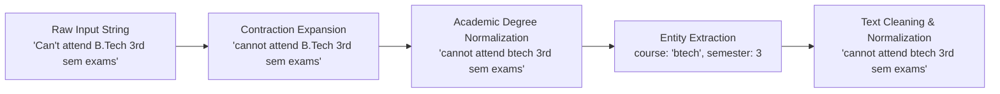

# Dataset & Knowledge Base Specification

## UniAssist AI – Natural Language Understanding Dataset for University Queries

---

## 1. Overview

The natural language understanding (NLU) dataset for UniAssist AI is tailored to address the high-frequency queries encountered in higher-education institutions. The corpus comprises **408 labeled training queries** spanning **20 fine-grained intent categories**, supplemented by an authoritative **FAQ knowledge base** containing 25 verified university policies, deadlines, and procedural guidelines.

---

## 2. Intent Taxonomy & Sample Distribution

Each intent represents a distinct functional domain within the university ecosystem.

| # | Intent Identifier | Description | Training Samples | Representative Examples |
| :-: | :--- | :--- | :-: | :--- |
| **1** | `greeting` | Conversational greetings and friendly openings | 22 | *"Hello", "Good morning", "Hey bot, can you help me?"* |
| **2** | `goodbye` | Conversational exit and termination phrases | 21 | *"Bye", "Thank you, that is all", "Have a great day"* |
| **3** | `admissions` | General admission procedures, applications, deadlines | 21 | *"How can I apply for admission?", "When is the admission deadline?"* |
| **4** | `admission_eligibility` | Academic eligibility criteria, percentage cut-offs | 20 | *"What is the minimum percentage for B.Tech admission?", "Eligibility for MBA"* |
| **5** | `fee_payment` | Tuition fees, online payment portal, installments, late fines | 21 | *"How do I pay semester fees online?", "Is there a fine for late fee payment?"* |
| **6** | `course_information` | Degree programs, branch options, syllabus details | 20 | *"What courses are offered?", "Where can I find the B.Tech CSE syllabus?"* |
| **7** | `timetable` | Daily class timetables, section schedules | 20 | *"Where can I download my class timetable?", "What time do classes start?"* |
| **8** | `exam_schedule` | Mid-term, end-term dates, examination venues | 20 | *"When will end-semester exams begin?", "Where is the exam date sheet?"* |
| **9** | `exam_results` | Semester grade reports, marksheet publishing, backlogs | 20 | *"When will semester 4 results be declared?", "How do I check my GPA?"* |
| **10** | `attendance_policy` | Mandatory attendance percentage, medical leave rules | 20 | *"What is the minimum attendance required?", "What happens if attendance is below 75%?"* |
| **11** | `academic_calendar` | Semester start/end dates, registration windows | 20 | *"When does the monsoon semester start?", "Where can I view the academic calendar?"* |
| **12** | `assignments` | Submission portals, homework deadlines, LMS guidelines | 20 | *"Where do I submit my course assignments?", "What happens if an assignment is late?"* |
| **13** | `faculty_contacts` | Professor office hours, email directories, department cabins | 20 | *"How do I contact my department head?", "Where is Professor Sharma's office?"* |
| **14** | `library_facilities` | Library timings, book borrowing limits, online journals | 20 | *"What are the central library working hours?", "How many books can a student borrow?"* |
| **15** | `hostel_information` | Hostel room allocation, warden contacts, mess fees | 20 | *"How do I apply for hostel accommodation?", "What are the hostel curfew timings?"* |
| **16** | `transport_facilities` | University bus routes, passes, parking permits | 20 | *"Does the university provide bus transport?", "How can I get a student bus pass?"* |
| **17** | `campus_amenities` | Cafeteria, sports complex, gym, medical clinic | 20 | *"Is there a health clinic on campus?", "Where is the gymnasium located?"* |
| **18** | `scholarships` | Merit scholarships, financial aid, fee waivers | 21 | *"Are there scholarships for meritorious students?", "How do I apply for financial aid?"* |
| **19** | `technical_support` | Student portal login issues, WiFi access, email resets | 21 | *"I forgot my ERP student portal password", "How do I connect to campus WiFi?"* |
| **20** | `university_holidays` | Gazetted holidays, winter break, festive closures | 21 | *"Is the university closed this Friday?", "When is the winter vacation?"* |
| **Total** | **20 Intents** | **Full Academic & Operational Scope** | **408 Samples** | |

---

## 3. Natural Language Preprocessing & Entity Extraction Pipeline

Real student queries frequently contain informal abbreviations, conversational slang, contractions, and varying casing. To maximize statistical classification accuracy, raw queries undergo multi-stage normalization via `ai_service/app/preprocessing.py`:

### 3.1 Contraction Expansion Dictionary
Common English contractions are programmatically expanded into their canonical forms:
- `can't` $\rightarrow$ `cannot`
- `won't` $\rightarrow$ `will not`
- `what's` $\rightarrow$ `what is`
- `where's` $\rightarrow$ `where is`
- `how's` $\rightarrow$ `how is`
- `i'm` $\rightarrow$ `i am`
- `i've` $\rightarrow$ `i have`

### 3.2 Academic Program Normalization
Academic degrees and program acronyms with varied punctuation are normalized into unified tokens:
- `B.Tech`, `BTech`, `B. Tech` $\rightarrow$ `btech`
- `M.Tech`, `MTech`, `M. Tech` $\rightarrow$ `mtech`
- `B.C.A.`, `BCA` $\rightarrow$ `bca`
- `M.C.A.`, `MCA` $\rightarrow$ `mca`
- `M.B.A.`, `MBA` $\rightarrow$ `mba`
- `B.Sc`, `BSc` $\rightarrow$ `bsc`
- `M.Sc`, `MSc` $\rightarrow$ `msc`
- `Ph.D.`, `PhD` $\rightarrow$ `phd`

### 3.3 Semester Entity Extraction
A specialized regular expression parser detects semester ordinal and numeric references:
- Regex: `\b(?:sem(?:ester)?|term)\s*([1-8])\b|\b([1-8])(?:st|nd|rd|th)?\s*sem(?:ester)?\b`
- Examples: `"3rd sem"`, `"semester 4"`, `"sem 6"` $\rightarrow$ `semester = 3 / 4 / 6`

---

## 4. FAQ Knowledge Base Architecture

The grounding knowledge base (`ai_service/data/faqs.csv` and MySQL `faqs` table) contains **25 authoritative question-and-answer pairs** across 7 primary categories:

1. **Admissions & Eligibility:** Application deadlines, JEE/CUET score requirements, and international student verification.
2. **Tuition & Finance:** Online SBI/HDFC payment gateways, installment schedules, and late registration surcharges.
3. **Examinations & Grading:** Mid-semester assessment weightage (30%), end-semester examinations (50%), internal grading (20%), and CGPA calculation guidelines.
4. **Academic Regulations:** Mandatory 75% attendance policy, condonation on medical grounds up to 10%, and assignment LMS submission protocols.
5. **Student Services & Housing:** On-campus hostel curfew hours (9:30 PM), mess meal menus, hostel security deposits, and medical emergency dispensary contacts.
6. **Campus Amenities & Library:** Central Library RFID automated self-checkout, open hours (8:00 AM - 10:00 PM), sports courts, and university shuttle schedules.
7. **IT & Digital Systems:** Eduroam and Campus WiFi SSID configuration, Active Directory password self-service resets, and ERP student portal navigation.

---

## 5. Dataset Validation & Integrity Checks

- **Stratified Partitioning:** The dataset is split into an 80% training set (326 queries) and a 20% held-out test set (82 queries) with stratified class distribution (`stratify=y`), ensuring exactly equal representation across all 20 intent classes in both partitions.
- **Leakage Prevention:** Vectorizer fit is performed strictly on the training partition; test samples are transformed without vocabulary leakage.
- **Automated Test Validation:** Pytest suite in `ai_service/tests/test_preprocessing.py` verifies unicode preservation, zero null entries, and regex stability across all test cases.
