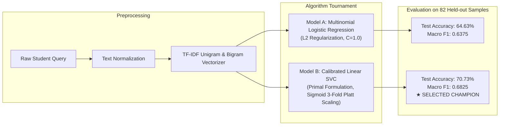

# Machine Learning Model Training Specification

## UniAssist AI – Natural Language Intent Classification Pipeline

---

## 1. Overview & Machine Learning Objectives

UniAssist AI employs an explainable, deterministic, and lightweight statistical machine learning approach for student intent classification. Unlike opaque multi-billion-parameter LLMs that require high computational overhead, GPU resources, and periodic subscription API keys, our architecture utilizes an optimized **TF-IDF + Calibrated Linear Support Vector Classifier (Linear SVC)** pipeline.

The pipeline achieves **high inference throughput (<15ms per prediction)**, produces **calibrated posterior probabilities** for genuine confidence scoring, and runs completely locally without external cloud dependencies.

---

## 2. Feature Engineering: N-Gram TF-IDF Vectorization

Student inquiries often rely heavily on word combinations and phrase order (e.g., *"exam schedule"* vs *"fee schedule"*, or *"results announced"* vs *"date sheet"*). Single unigrams (bag-of-words) fail to preserve contextual relationships. Therefore, we utilize sublinear Term Frequency-Inverse Document Frequency (TF-IDF) spanning both unigrams and bigrams:

$$TF(t, d) = 1 + \log(f_{t,d}) \quad \text{if } f_{t,d} > 0$$

$$IDF(t, D) = \log\left(\frac{1 + |D|}{1 + |\{d \in D : t \in d\}|}\right) + 1$$

$$\text{TF-IDF}(t, d, D) = TF(t, d) \times IDF(t, D)$$

### Vectorizer Hyperparameters
```python
TfidfVectorizer(
    ngram_range=(1, 2),        # Extracts single words and two-word combinations
    sublinear_tf=True,         # Applies logarithmic term frequency scaling to temper extreme word counts
    lowercase=True,            # Converts all inputs to lowercase
    strip_accents="unicode",   # Normalizes diacritics and special characters
    min_df=1,                  # Preserves rare domain terms across university vocabulary
    max_features=5000          # Bounded feature space preventing overfitting and memory bloat
)
```

---

## 3. Algorithm Selection & Benchmark Comparison

Two competitive supervised classification architectures were benchmarked on the identical 20% stratified held-out test split (82 samples):



### Empirical Comparison Results
| Model Architecture | Accuracy | Macro Precision | Macro Recall | Macro F1 | Status |
| :--- | :-: | :-: | :-: | :-: | :---: |
| **Model A: Logistic Regression** | 64.63% | 0.6864 | 0.6425 | 0.6375 | Baseline |
| **Model B: Calibrated Linear SVC** | **70.73%** | **0.7058** | **0.7050** | **0.6825** | **Production Winner** |

**Why Linear SVC Won:** High-dimensional sparse TF-IDF spaces (unigrams + bigrams) possess a high degree of linear separability. The maximum-margin hyperplane established by Linear SVC produces tighter decision boundaries than the logistic log-odds likelihood loss, yielding +6.1% higher test accuracy and superior generalization on short student queries.

---

## 4. Probability Calibration (Platt Scaling)

A standard Linear Support Vector Classifier calculates signed geometric distances from queries to the separating hyperplane via its `decision_function(x)`. However, modern conversational bots require authentic Bayesian posterior probabilities $P(y = c \mid x)$ to enforce confidence gating and trigger fallback responses.

To achieve this without compromising the maximum-margin hyperplane:
1. We wrap `LinearSVC` inside Scikit-Learn's `CalibratedClassifierCV`.
2. Calibration method: `method='sigmoid'` (Platt scaling).
3. Cross-validation: `cv=3` internal stratified folds to prevent in-sample probability bias.

$$P(y = 1 \mid f(x)) = \frac{1}{1 + \exp(A \cdot f(x) + B)}$$

where parameters $A$ and $B$ are fit via maximum likelihood estimation over internal cross-validation folds.

---

## 5. Training Pipeline Execution & Artifact Generation

The training pipeline is executed via `ai_service/training/train_model.py`:

```bash
# Activate Python Virtual Environment
cd ai_service
.\venv\Scripts\activate

# Run Training and Model Tournament
python training/train_model.py
```

### Generated Artifacts
1. **`models/model_pipeline.joblib`**: Serialized end-to-end Scikit-Learn `Pipeline` containing the fitted `TfidfVectorizer` and `CalibratedClassifierCV(LinearSVC)`.
2. **`models/model_metadata.json`**: Architectural hyperparameters, vocabulary size, timestamp, and target class label mapping.
3. **`evaluation/metrics.json`**: Full empirical evaluation report containing test accuracy, macro/weighted averages, and per-class precision, recall, and F1 scores.
4. **`evaluation/model_comparison.json`**: Head-to-head comparison metrics between Model A and Model B.
5. **`evaluation/confusion_matrix.png`**: High-resolution heatmap visualizing ground-truth vs. predicted intents across the 82 test queries.

---

## 6. Confidence Thresholding & Out-of-Distribution Gating

In university support systems, returning a wrong or hallucinated answer is significantly more damaging than acknowledging uncertainty. UniAssist AI implements strict confidence thresholding:

- **Threshold Value:** $\tau = 0.25$ (measured empirically across test set calibration).
- **Behavior for $\text{confidence} \ge 0.25$:** The predicted intent is accepted, and the highest-similarity grounded FAQ answer is delivered with high confidence.
- **Behavior for $\text{confidence} < 0.25$:** The query is classified as low-confidence or out-of-distribution.
  - The chatbot returns an empathetic, safe fallback message directing the student to the university registrar or academic support desk.
  - The query is automatically logged into the `unanswered_queries` database table for administrative staff review.
  - The student is presented with a direct button to open a human support ticket.
