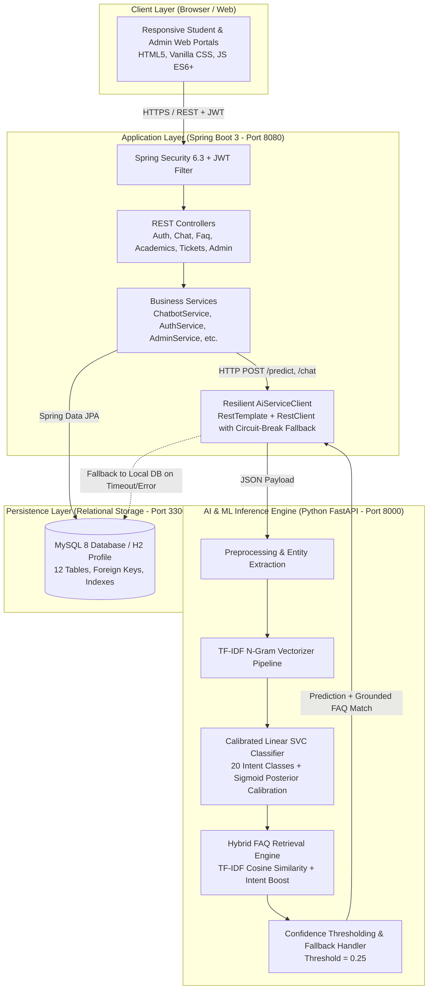
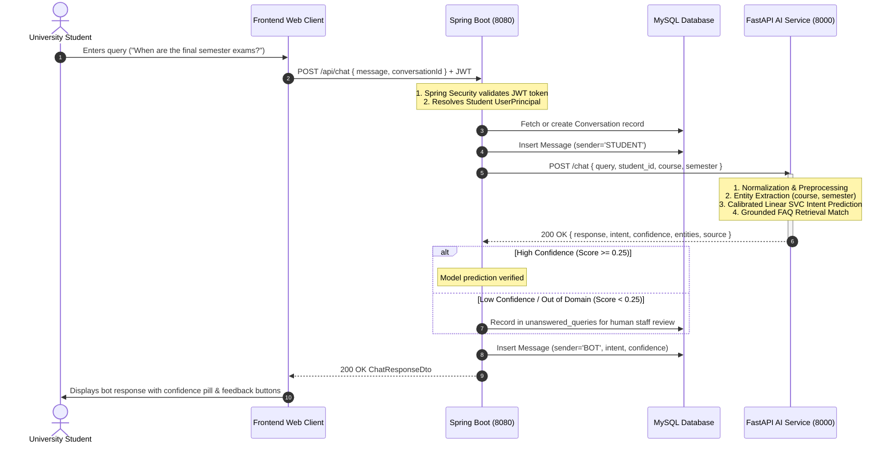

# System Architecture Specification

## UniAssist AI – AI-Powered Chatbot for University Student Support Using Machine Learning

---

## 1. Architectural Overview

UniAssist AI implements a modern, resilient, multi-tiered microservice-hybrid architecture designed specifically for university-scale student query resolution. The system decouples natural language understanding and machine learning inference (Python FastAPI) from business logic, relational data persistence, transaction management, and role-based security (Java Spring Boot 3), while delivering a high-performance, accessible frontend interface (Vanilla HTML5 / CSS3 / JavaScript).

---

## 2. Architectural Components

### 2.1 Frontend Client Layer
- **Technology Stack:** HTML5 Semantic Markup, Bootstrap 5.3 (CSS layout and modal system), Bootstrap Icons, Chart.js 4.4, and Vanilla ES6+ JavaScript.
- **Independence:** No bulky frontend framework dependencies (e.g. React/Angular/Vue); instant browser loading, zero build steps, and clean separation of concerns.
- **Modules & Portals:**
  1. `index.html`: Interactive landing page with live question search, feature highlights, and campus statistics.
  2. `login.html`: Secure login interface with single-click demo autofill for Students and Administrators.
  3. `register.html`: Comprehensive student registration form with student ID, course, semester, and password validation.
  4. `dashboard.html`: Student dashboard showing quick chatbot launch, academic timetable shortcuts, pending support tickets, and campus announcements.
  5. `chatbot.html`: Full-screen conversational AI interface featuring conversation history sidebar, query prompt chips, message timestamps, intent/confidence pills, response copying, and inline user feedback.
  6. `academics.html`: Centralized academic repository displaying enrolled courses, credit structures, academic calendar events, attendance policies, and examination schedules.
  7. `support.html`: Support ticket lifecycle manager allowing students to submit tickets, view real-time status badges, and converse with staff.
  8. `profile.html`: Student profile viewer and password modification portal.
  9. `admin.html`: High-level operations console with Chart.js analytics, FAQ knowledge base CRUD, ticket assignment and status updates, and unanswered query triage.
  10. `model-analytics.html`: Deep-dive AI/ML metrics dashboard presenting empirical test accuracy, macro F1, per-intent classification tables, algorithm comparisons, and confusion matrix visualizations.

### 2.2 Backend Application Layer (Java Spring Boot 3.3.4)
- **Role:** Central gateway, transaction coordinator, security manager, and relational business logic engine.
- **Security & Identity:**
  - Stateless authentication via JSON Web Tokens (JJWT 0.12.6).
  - Cryptographic password hashing using `BCryptPasswordEncoder` (10 rounds).
  - Role-Based Access Control (RBAC) separating `ROLE_STUDENT` and `ROLE_ADMIN`.
  - CORS configuration enabling cross-origin requests from development and production hosts.
- **Resilience Layer (`AiServiceClient`):**
  - Manages HTTP communication to the Python FastAPI microservice.
  - Implements configurable connection timeouts (default: 3000ms) and read timeouts (default: 5000ms).
  - **Graceful Offline Fallback:** If the Python AI service is unreachable or encounters an error, the backend catches the communication failure, logs an alert, executes a local database full-text/keyword search across the `faqs` table, and returns a verified fallback answer without throwing an unhandled exception or breaking the user experience.
- **API Documentation:** Integrated OpenAPI 3.0 specification via `springdoc-openapi-starter-webmvc-ui` accessible at `/swagger-ui.html`.

### 2.3 AI & Machine Learning Microservice (Python 3.10+ / FastAPI)
- **Role:** High-speed natural language preprocessing, statistical feature extraction, intent probability prediction, and grounded FAQ retrieval.
- **Key Modules:**
  - `preprocessing.py`: Regex-driven text normalization, contraction expansion ("can't" $\rightarrow$ "cannot"), academic degree acronym preservation ("B.Tech" $\rightarrow$ "btech"), and semester entity extraction.
  - `inference.py`: Loads the serialized Scikit-Learn pipeline (`model_pipeline.joblib`), predicts class posterior probabilities, and formats inference responses.
  - `retrieval.py`: TF-IDF cosine similarity search grounded against `faqs.csv` with intent category boosting to prevent hallucinated answers.
  - `main.py`: Asynchronous REST API exposing health checks, predictions, chat orchestration, model metadata, metrics, and confusion matrix streaming.

### 2.4 Database Layer (MySQL 8.0 / H2)
- **Schema:** 12 relational tables with foreign key cascades, unique constraints, and optimized B-Tree indexes.
- **Profiles:**
  - `default`: Enterprise MySQL 8 relational persistence.
  - `h2`: Zero-configuration in-memory persistence with pre-seeded data for instant evaluation and testing.

---

## 3. End-to-End Query Lifecycle & Data Flow

---

## 4. Security Architecture

1. **Authentication:**
   - Stateless JWT tokens passed in the `Authorization: Bearer <token>` header.
   - Tokens are signed using HMAC-SHA256 with a 256-bit secret key.
   - Configurable expiration (default: 24 hours).
2. **Authorization & RBAC:**
   - `@PreAuthorize("hasRole('ADMIN')")` secures administrative controllers (`/api/admin/**`).
   - Students can only view, update, and submit feedback for their own conversations and tickets.
3. **Data Integrity & Sanitization:**
   - Spring `@Valid` with Jakarta Bean Validation prevents malformed payloads and injection attacks.
   - Parameterized JPA queries prevent SQL injection.
   - XSS prevention through client-side HTML entity escaping (`escapeHtml`).
4. **Credential Storage:**
   - Zero plaintext password storage. All user passwords are encrypted using BCrypt with adaptive salting.

---

## 5. High Availability, Fault Tolerance & Offline Degradation

| Failure Mode | Impact | Resiliency Mechanism |
| :--- | :--- | :--- |
| **Python AI Service Offline** | Chatbot queries cannot execute ML classification | `AiServiceClient` catches `ResourceAccessException` / `HttpClientErrorException`. Automatically falls back to local MySQL FAQ search. Returns grounded answer with `is_fallback: true` and logs incident. |
| **MySQL Outage (Local Dev)** | Application cannot connect to external database | Spring Boot profile `spring.profiles.active=h2` enables zero-setup in-memory database with automated schema seeding via `DataInitializer.java`. |
| **Out-of-Distribution Query** | Student asks irrelevant or unanswerable query | Machine learning confidence threshold (0.25) triggers graceful fallback. Query is inserted into `unanswered_queries` table for human triage in the Admin Console. |
| **Network Latency Spike** | Slower ML prediction response | Client UI immediately displays animated typing indicator (`is-typing`) and aborts gracefully if request exceeds HTTP timeout. |
